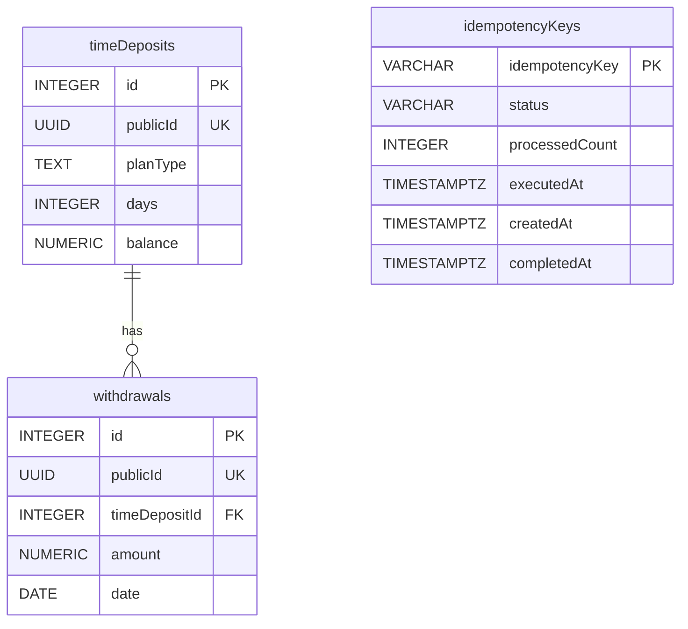

# ADR-0006: Data model

- **Status:** Proposed
- **Date:** 2026-10-31

## Context
The brief requires two PostgreSQL tables:
- `timeDeposits`: `id` Integer (primary key), `planType` String (required), `days` Integer (required),
  `balance` Decimal (required);
- `withdrawals`: `id` Integer (primary key), `timeDepositId` Integer (foreign key, required), `amount` Decimal
  (required), `date` Date (required).

ADR-0004 adds two needs: a public UUID per time deposit and withdrawal (API `id` ↔ DB `publicId`), and storage for
idempotency keys with their outcomes (24-hour retention). The legacy `TimeDeposit` holds `int id` and
`Double balance`, and `updateBalance` adds a 2-decimal interest to that `Double`. The Flyway migrations and JPA
mapping are written in the persistence step; this ADR fixes the schema they implement.

Readings decided here:
- **"Store all time deposit plans"**: the time deposits themselves are stored, one row per deposit; plan
  definitions (rates, rules) stay in code. The brief defines no plan table, and storing rules would make the
  calculator no longer the source of truth.
- **"Define the following tables"**: the minimum required, not the only tables allowed; the brief has no "only".
  `publicId` columns and an idempotency table are added because ADR-0004 needs them.

## Options considered
- **Naming:** quoted camelCase (`"timeDeposits"`, exactly the brief's names) · snake_case (`time_deposits`,
  PostgreSQL convention, no quoting, but not the brief's names) · unquoted camelCase (written `timeDeposits`,
  stored as `timedeposits` because PostgreSQL folds unquoted identifiers to lower case — misleading).
- **Money columns:** scaled `NUMERIC` · `NUMERIC` without scale (stores the legacy `Double` exactly, float noise
  included, and the noise accumulates in the database) · `DOUBLE PRECISION` (lossless with `Double`, but binary
  floating point, not the brief's Decimal).
- **Primary keys:** `INTEGER` identity · `BIGINT` identity (needs narrowing into `TimeDeposit`'s `int id`, with an
  overflow risk, and is not the brief's Integer).
- **Constraints:** value ranges without a `planType` list · `NOT NULL` only (invalid values would depend on the
  application alone) · value ranges plus a `planType` list (rejects plans the legacy code handles).
- **Withdrawal foreign key on delete:** `RESTRICT` · `CASCADE` (silently deletes withdrawal history).
- **publicId generation:** database default · application-generated (every writer, including seed scripts, must
  remember to supply it).
- **Idempotency storage:** typed table with the balance update's outcome · generic HTTP snapshot (status + JSON
  body; reusable, but puts the HTTP representation into persistence) · log of all balance update runs with a
  nullable unique key (an audit trail beyond the brief, with more complex retention).
- **Seed data:** separate Flyway location under a `demo` profile · always, as a schema migration (demo rows in
  every environment and in the schema history) · Java runner under a `demo` profile (code that duplicates
  migration tooling).

## Decision

Types are abbreviated in the diagram; the exact types follow below.

### Naming
**Quoted camelCase**, exactly the brief's names: `"timeDeposits"`, `"planType"`, `"timeDepositId"`; the added
table and columns follow the same convention (`"publicId"`, `"idempotencyKeys"`). A reviewer finds the tables and
columns as specified. Every SQL statement and JPA mapping must quote them. The mapping states every name
explicitly; Spring Boot's default physical naming strategy may still rewrite explicit names to snake_case, so the
persistence step is expected to configure `PhysicalNamingStrategyStandardImpl` (unverified; checked there together
with the Hibernate quoting mechanism).

### Types
- **Primary keys:** `INTEGER GENERATED ALWAYS AS IDENTITY` — the brief's Integer and `TimeDeposit`'s `int id`
  without narrowing. Seed rows do not hard-code ids; withdrawals reference their deposit through its fixed
  `publicId`.
- **`publicId`:** `UUID NOT NULL UNIQUE DEFAULT gen_random_uuid()` on both tables — a random (version 4) UUID as
  ADR-0004 requires, built into PostgreSQL 13 and later (to be verified in the persistence step). Any writer gets
  a UUID without application code; seed rows may set fixed UUIDs; any future insert path (and tests) reads the
  generated value back after an insert.
- **`balance`, `amount`:** `NUMERIC(15,2)` — cent precision, maximum `9,999,999,999,999.99`. The precision
  enforces the bound the balance mapping relies on (below 10^13).
- **`days`:** `INTEGER`; the age as stored, never advanced (ADR-0004).
- **`planType`:** `TEXT`; free text without a length limit, so any value the legacy code accepts can be stored
  (see Constraints).
- **`date`:** `DATE`, a calendar date without time zone.

### Balance mapping (`Double` ↔ `NUMERIC(15,2)`)
- **Read:** `BigDecimal.doubleValue()` into `TimeDeposit`.
- **Write:** `BigDecimal.valueOf(balance).setScale(2, RoundingMode.HALF_UP)`.
- **Why this does not change the legacy result:** the stored balance has 2 decimals and `updateBalance` adds an
  interest rounded to 2 decimals, so the exact decimal sum has 2 decimals. The `Double` addition can add float
  noise (`1000.10 + 0.83` gives `1000.9300000000001`). Below 2^44 (about 1.76 × 10^13) one unit in the last place
  is at most 2^-9; reading the stored value, the interest, the addition and `BigDecimal.valueOf` together stay
  at most 4 × 2^-10 ≈ 0.0039, below 0.005, so rounding to scale 2 recovers the exact sum. `BigDecimal.valueOf`
  relies on `Double.toString` returning a decimal that converts back to the same `Double`, so it lies within half
  a unit in the last place of it. Because the error stays below half a cent, the rounding mode does not
  affect the result; `HALF_UP` is chosen for consistency with the legacy calculator.
- **Baseline:** the equivalence holds **per call**, given the balance as stored. Float noise from an earlier call
  is deliberately not carried into the next one, as an in-memory chain of legacy calls would; at a half-cent edge
  the two could round differently. Legacy has no persistence, so this is not a regression.

### Constraints
- All brief-required columns are `NOT NULL`.
- `CHECK (balance >= 0)`, `CHECK (days >= 0)`, `CHECK (amount > 0)`. A zero withdrawal is meaningless; `> 0` is
  stricter than the contract's "non-negative", so stored data always fits the contract.
- **No `CHECK` on `planType`:** the legacy calculator accepts unknown plan types and applies 0% interest; a value
  list would make that behaviour impossible to store and would need a migration for every new plan.
- **Foreign key:** `"timeDepositId"` references `"timeDeposits"(id)` `ON DELETE RESTRICT` — withdrawal history is
  never removed as a side effect (nothing deletes deposits today). The column is indexed for the list query.

### Idempotency keys
Table `"idempotencyKeys"`, only for requests that send an `Idempotency-Key` (ADR-0004):
- `idempotencyKey VARCHAR(255) PRIMARY KEY` — the header allows 1–255 characters (not `key`, an SQL keyword);
- `status VARCHAR(20) NOT NULL`, `CHECK (status IN ('IN_PROGRESS', 'COMPLETED'))`;
- `processedCount INTEGER` (`>= 0`) and `executedAt TIMESTAMPTZ` — the balance update's outcome, `NULL` while in
  progress;
- `createdAt TIMESTAMPTZ NOT NULL`, `completedAt TIMESTAMPTZ`;
- `CHECK`, both directions: a row is `COMPLETED` if and only if `processedCount`, `executedAt` and `completedAt`
  are all set — `(status = 'COMPLETED') = (processedCount IS NOT NULL AND executedAt IS NOT NULL AND completedAt IS
  NOT NULL)`.

Rules for using the table:
- It stores the domain outcome, not an HTTP response; the REST adapter re-renders the same status and body from it.
- **Same transaction:** the switch to `COMPLETED` (with `processedCount`, `executedAt`, `completedAt`) is written
  in the same transaction as the balance updates. A crash then leaves either both or neither; otherwise a retry
  could apply interest twice.
- **Failure:** a failed request deletes its row ("stores nothing"). A row left `IN_PROGRESS` by a crash is stale
  once the in-flight timeout (derived from `createdAt`) has passed; it is then taken over or removed, never kept
  forever.
- **Replay:** `executedAt` is truncated to microseconds (the precision of `TIMESTAMPTZ`) before it is returned and
  stored, so a replay returns the same value as the original response.
- **Assumptions:** keys are global, not per client — the API has no authentication (ADR-0004), so two clients
  using the same key share one outcome. No request fingerprint: the only keyed operation takes no body, so the same
  key cannot carry a different request; a second keyed operation would need an operation column or a fingerprint.

The in-flight timeout, serialised runs, the order of key check and lock, and the retention cleanup (24 hours,
ADR-0004) are decided in the planned *Hexagonal architecture* ADR.

### Seed data
Schema migrations live in `db/migration`; seed data in a separate location (`db/seed`), added to Flyway's locations
only in a `demo` profile, which Docker Compose enables. Integration tests start from an empty schema and insert
their own data; no other environment gets demo rows. The seed covers:
- every plan at its boundaries: `basic` 30/31 days, `student` 30/31 and 365/366, `premium` 45/46;
- `days = 0`;
- an unknown plan type and `Basic` (case-sensitive matching), both with `days > 30` so that only the plan type
  explains the missing interest;
- a zero balance and a large balance (`1,000,000,000.00`) that leaves room for many interest runs below the
  column maximum;
- half-cent interest edges, both `basic` with `days > 30`: balance `6.00` (binary interest just above 0.005,
  rounded up to 0.01, as decimal rounding would — control case) and balance `18.00` (binary interest just below
  0.015, rounded down to 0.01 where decimal `HALF_UP` would give 0.02);
- deposits with several, one and no withdrawals.

## Consequences
- The persistence adapter quotes every identifier; a forgotten quote fails at startup or in the integration tests,
  not silently.
- Stored balances are always at cent precision; the API's 2-decimal representation (ADR-0004) is then lossless.
- Balances of `10^13` or more cannot be stored; an update that would exceed the column fails instead of losing
  precision. Because a balance update stores all deposits in one transaction, one such deposit aborts the whole
  run (all-or-nothing); how single-deposit failures are handled is decided in the planned *Hexagonal
  architecture* ADR.
- Unknown plan types can be stored and earn no interest, exactly as in the legacy calculator.
- How Flyway numbers and orders migrations across the two locations is settled in the persistence step.
- **Verification (persistence step, Testcontainers):**
  - schema: the tables and columns exist with the brief's exact names; `NOT NULL` and `CHECK` constraints reject
    invalid rows; `RESTRICT` blocks deleting a deposit with withdrawals; `publicId` is generated when omitted;
  - mapping: a `Double` ↔ `NUMERIC(15,2)` round trip, including a float-noise sum (`1000.10 + 0.83`) stored as
    `1000.93`;
  - idempotency: the `COMPLETED` update commits or rolls back together with the balance updates;
  - seed: loaded only with the `demo` profile and covering every case listed above.
