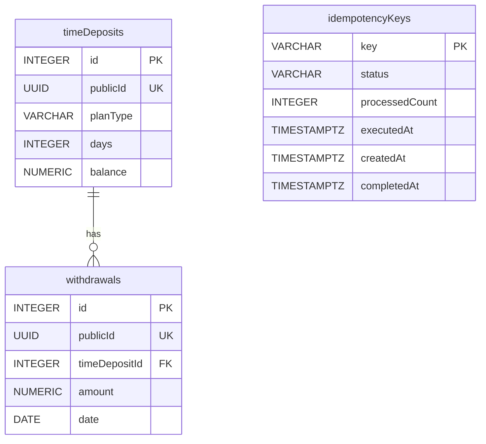

# ADR-0006: Data model

- **Status:** Proposed
- **Date:** 2026-10-31

## Context
The brief requires two PostgreSQL tables:
- `timeDeposits`: `id` Integer (primary key), `planType` String (required), `days` Integer (required),
  `balance` Decimal (required);
- `withdrawals`: `id` Integer (primary key), `timeDepositId` Integer (foreign key, required), `amount` Decimal
  (required), `date` Date (required).

ADR-0004 adds two needs: a public UUID per time deposit and withdrawal (API `id` ↔ DB `publicId`), and storage for
idempotency keys with their outcomes (24-hour retention). The legacy `TimeDeposit` holds `int id` and
`Double balance`, and `updateBalance` adds a 2-decimal interest to that `Double`. The Flyway migrations and JPA
mapping are written in the persistence step; this ADR fixes the schema they implement.

Readings decided here:
- **"Store all time deposit plans"**: the time deposits themselves are stored, one row per deposit; plan
  definitions (rates, rules) stay in code. The brief defines no plan table, and storing rules would make the
  calculator no longer the source of truth.
- **"Define the following tables"**: the minimum required, not the only tables allowed; the brief has no "only".
  `publicId` columns and an idempotency table are added because ADR-0004 needs them.

## Options considered
- **Naming:** quoted camelCase (`"timeDeposits"`, exactly the brief's names) · snake_case (`time_deposits`,
  PostgreSQL convention, no quoting) · unquoted camelCase (written `timeDeposits`, stored as `timedeposits`
  because PostgreSQL folds unquoted identifiers to lower case).
- **Money columns:** `NUMERIC(19,2)` · `NUMERIC` without scale (stores the legacy `Double` exactly, float noise
  included) · `DOUBLE PRECISION` (lossless with `Double`, but binary floating point, not the brief's Decimal).
- **Primary keys:** `INTEGER` identity · `BIGINT` identity (needs narrowing into `TimeDeposit`'s `int id`).
- **Constraints:** value ranges without a `planType` list · `NOT NULL` only · value ranges plus a `planType` list.
- **Withdrawal foreign key on delete:** `RESTRICT` · `CASCADE`.
- **publicId generation:** database default · application-generated.
- **Idempotency storage:** typed table with the balance update's outcome · generic HTTP snapshot (status + JSON
  body) · log of all balance update runs with a nullable unique key.
- **Seed data:** separate Flyway location under a `demo` profile · always, as a schema migration · Java runner
  under a `demo` profile.

## Decision

### Naming
**Quoted camelCase**, exactly the brief's names: `"timeDeposits"`, `"planType"`, `"timeDepositId"`; the added
table and columns follow the same convention (`"publicId"`, `"idempotencyKeys"`). A reviewer finds the tables and
columns as specified. Every SQL statement and JPA mapping must quote them; the persistence step states the names
explicitly in the mapping instead of relying on Spring Boot's default naming strategy (which would produce
snake_case), and verifies the Hibernate quoting mechanism.

### Types
- **Primary keys:** `INTEGER GENERATED ALWAYS AS IDENTITY` — the brief's Integer and `TimeDeposit`'s `int id`
  without narrowing. Seed rows do not hard-code ids; withdrawals reference their deposit through its fixed
  `publicId`.
- **`publicId`:** `UUID NOT NULL UNIQUE DEFAULT gen_random_uuid()` on both tables (built into PostgreSQL 13 and
  later; to be verified in the persistence step). Any writer gets a UUID without application code; seed rows may
  set fixed UUIDs.
- **`balance`, `amount`:** `NUMERIC(19,2)`, money at cent precision.
- **`days`:** `INTEGER`; the age as stored, never advanced (ADR-0004).
- **`planType`:** `VARCHAR(50)`; free text (see Constraints).
- **`date`:** `DATE`, a calendar date without time zone.

### Balance mapping (`Double` ↔ `NUMERIC(19,2)`)
- **Read:** `BigDecimal.doubleValue()` into `TimeDeposit`.
- **Write:** `BigDecimal.valueOf(balance).setScale(2, RoundingMode.HALF_UP)`.
- **Why this is not a change of the legacy result:** the stored balance has 2 decimals and `updateBalance` adds an
  interest rounded to 2 decimals, so the exact decimal sum has 2 decimals. The `Double` addition can add float
  noise (e.g. `1000.9300000000001`); for balances below 10^13 that error is far below 0.005, so rounding to scale 2
  recovers the exact sum. Assumption: balances stay below 10^13 (a `Double` cannot hold cent precision much
  beyond that anyway). The rounding mode is the one the legacy calculator uses for interest.

### Constraints
- All brief-required columns are `NOT NULL`.
- `CHECK (balance >= 0)`, `CHECK (days >= 0)`, `CHECK (amount > 0)`. A zero withdrawal is meaningless; `> 0` is
  stricter than the contract's "non-negative", so stored data always fits the contract.
- **No `CHECK` on `planType`:** the legacy calculator accepts unknown plan types and applies 0% interest; a value
  list would make that behaviour impossible to store and would need a migration for every new plan.
- **Foreign key:** `"timeDepositId"` references `"timeDeposits"(id)` `ON DELETE RESTRICT` — withdrawal history is
  never removed as a side effect (nothing deletes deposits today). The column is indexed for the list query.

### Idempotency keys
Table `"idempotencyKeys"`, only for requests that send an `Idempotency-Key` (ADR-0004):
- `key VARCHAR(255) PRIMARY KEY` — the header allows 1–255 characters;
- `status VARCHAR(20) NOT NULL`, `CHECK (status IN ('IN_PROGRESS', 'COMPLETED'))`;
- `processedCount INTEGER` (`>= 0`) and `executedAt TIMESTAMPTZ` — the balance update's outcome, `NULL` while in
  progress;
- `createdAt TIMESTAMPTZ NOT NULL`, `completedAt TIMESTAMPTZ`;
- `CHECK`: a `COMPLETED` row has `processedCount`, `executedAt` and `completedAt`.

It stores the domain outcome, not an HTTP response; the REST adapter re-renders the same status and body from it.
No request fingerprint: the operation takes no body, so the same key cannot carry a different request. A failed
request deletes its row ("stores nothing"). In-flight detection for `409` (e.g. a timeout derived from
`createdAt`), serialised runs and removal after 24 hours from `completedAt` are decided in the planned *Hexagonal
architecture* ADR.

### Seed data
Schema migrations live in `db/migration`; seed data in a separate location (`db/seed`), added to Flyway's locations
only in a `demo` profile, which Docker Compose enables. Integration tests start from an empty schema and insert
their own data; no other environment gets demo rows. The seed covers:
- every plan at its boundaries: `basic` 30/31 days, `premium` 45/46, `student` 31 and 365/366;
- an unknown plan type and `Basic` (case-sensitive matching: no interest);
- a zero balance and a balance whose interest hits a half-cent rounding edge;
- deposits with several, one and no withdrawals.

## Consequences
- The persistence adapter quotes every identifier; a forgotten quote fails at startup or in the integration tests,
  not silently.
- Stored balances are always at cent precision; the API's 2-decimal representation (ADR-0004) is then lossless.
- Unknown plan types can be stored and earn no interest, exactly as in the legacy calculator.
- How Flyway numbers and orders migrations across the two locations is settled in the persistence step.
- **Verification (persistence step, Testcontainers):**
  - schema: the tables and columns exist with the brief's exact names; `NOT NULL` and `CHECK` constraints reject
    invalid rows; `RESTRICT` blocks deleting a deposit with withdrawals; `publicId` is generated when omitted;
  - mapping: a `Double` ↔ `NUMERIC(19,2)` round trip, including a float-noise sum (e.g. `1000.10 + 0.83`) that is
    stored as the exact decimal value;
  - seed: loaded only with the `demo` profile and covering every case listed above.
