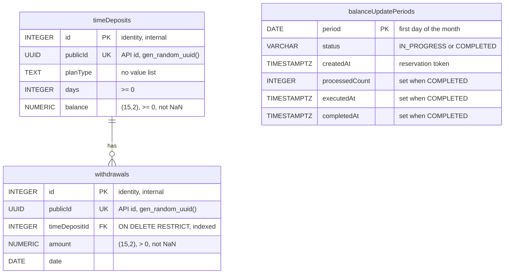
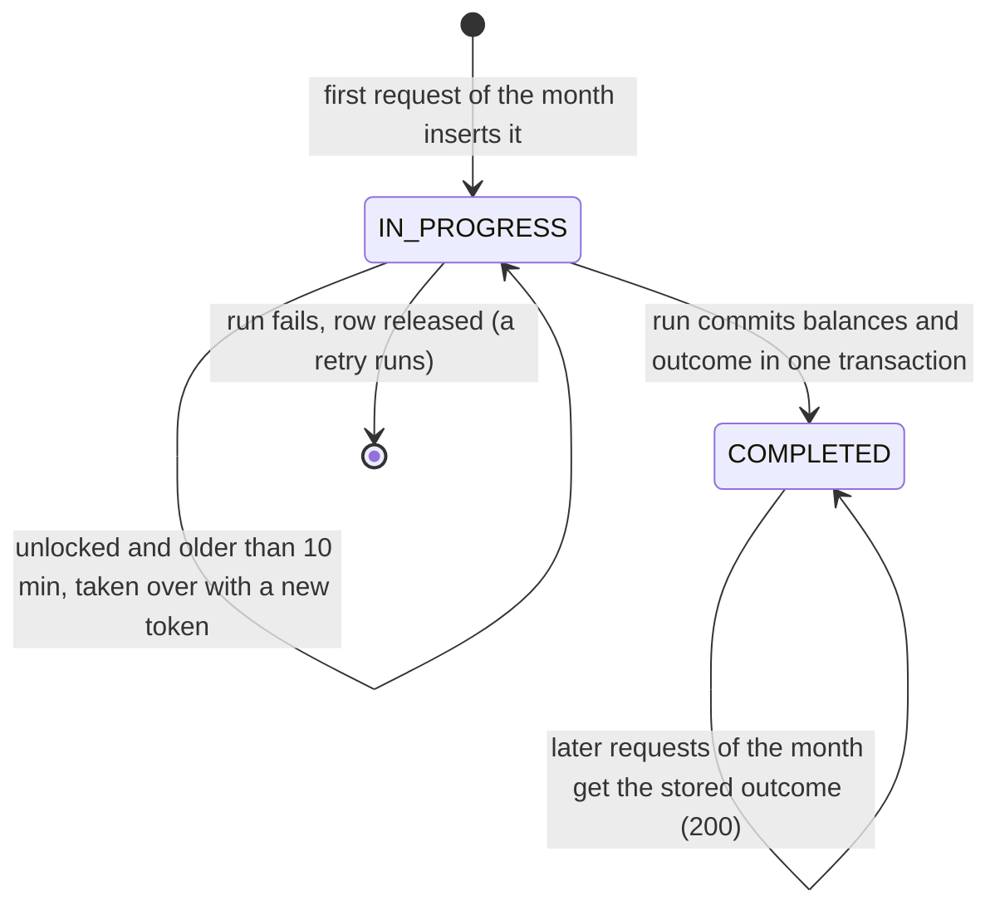

# Data model (current)

The schema as it is **today**, after all Flyway migrations, and how the Java side maps it. The ADRs record why each
decision was taken and are not edited once accepted; this page is kept current instead. **Every pull request that
adds a migration or changes the mapping updates this page.**

## Tables

Identifiers are quoted camelCase, exactly the brief's names (`"timeDeposits"`, `"planType"`); every SQL statement and
JPA mapping quotes them. All columns not marked nullable below are `NOT NULL`.

### `"timeDeposits"` — business data (brief)
| Column | Type | Constraints | Meaning | Decided in |
|---|---|---|---|---|
| `id` | `INTEGER GENERATED ALWAYS AS IDENTITY` | PK | Internal key = legacy `TimeDeposit.id`; never in the API | ADR-0006 |
| `publicId` | `UUID` | `UNIQUE`, default `gen_random_uuid()` | The API `id` | ADR-0004, ADR-0006 |
| `planType` | `TEXT` | — (no value list) | `basic`, `student`, `premium`; unknown plans are stored and earn 0% | ADR-0006, ADR-0011 |
| `days` | `INTEGER` | `>= 0` | Age of the deposit as stored; never advanced by the application | ADR-0004, ADR-0006 |
| `balance` | `NUMERIC(15,2)` | `>= 0`, `<> 'NaN'` | Cent precision, below 10^13 | ADR-0006, ADR-0012 F |

### `"withdrawals"` — business data (brief)
| Column | Type | Constraints | Meaning | Decided in |
|---|---|---|---|---|
| `id` | `INTEGER GENERATED ALWAYS AS IDENTITY` | PK | Internal key; never in the API | ADR-0006 |
| `publicId` | `UUID` | `UNIQUE`, default `gen_random_uuid()` | The API `id` of a withdrawal | ADR-0004, ADR-0006 |
| `timeDepositId` | `INTEGER` | FK → `"timeDeposits"("id")` `ON DELETE RESTRICT`; indexed | Owning deposit; history is never deleted as a side effect | ADR-0006 |
| `amount` | `NUMERIC(15,2)` | `> 0`, `<> 'NaN'` | A zero withdrawal is meaningless | ADR-0006, ADR-0012 F |
| `date` | `DATE` | — | Calendar date, no time zone | ADR-0006 |

Withdrawals are only read (the list endpoint); no application code writes them. Rows come from the demo seed (and
from the integration tests' own setup).

### `"balanceUpdatePeriods"` — control data (one row per month with a balance update)
| Column | Type | Constraints | Meaning | Decided in |
|---|---|---|---|---|
| `period` | `DATE` | PK, `CHECK (extract(day from "period") = 1)` | The UTC calendar month, stored as its first day (`2026-11-01`) | ADR-0013 |
| `status` | `VARCHAR(20)` | `IN_PROGRESS` or `COMPLETED` | Whether the month's run has completed | ADR-0012, ADR-0013 |
| `createdAt` | `TIMESTAMPTZ` | — | Reservation time (microseconds) = the run's fencing token; a takeover replaces it | ADR-0012 C |
| `processedCount` | `INTEGER`, nullable | `>= 0` | Outcome: deposits processed, incl. unchanged ones | ADR-0004, ADR-0013 |
| `executedAt` | `TIMESTAMPTZ`, nullable | — | Outcome: when the run executed (returned to every request of the month) | ADR-0004, ADR-0013 |
| `completedAt` | `TIMESTAMPTZ`, nullable | — | When the row switched to `COMPLETED` | ADR-0012, ADR-0013 |

Two-state `CHECK`: `IN_PROGRESS` has all three outcome columns `NULL`; `COMPLETED` has all three set. The table has
no relation to the deposits: it records *that* a month was applied and its outcome, not per-deposit changes. Rows are
never purged (twelve a year). All times come from the application clock in UTC, never from the database.

## Lifecycle of a month row

- While a request of the month finds the row `IN_PROGRESS` and the run is live → `409` (ADR-0012, ADR-0013).
- A `COMPLETED` row is final and read without a lock (ADR-0014).
- A past month left `IN_PROGRESS` (crash, failed release) is a missed month: kept, never taken over by later months
  (ADR-0013, E1).

## Java ↔ database
| Database | Persistence adapter (JPA / SQL) | Application and domain |
|---|---|---|
| `"timeDeposits"` | `TimeDepositEntity` (`@Entity`) | legacy `TimeDeposit(int id, String planType, Double balance, int days)` — no withdrawals, unchanged (hard constraint) |
| `"timeDeposits"` + `"withdrawals"` | `TimeDepositEntity` + `WithdrawalEntity` (`@OneToMany` / `@ManyToOne`) | read model `TimeDepositView(UUID id, terms, List<WithdrawalView>)` for `GET /time-deposits` |
| `"balanceUpdatePeriods"` | `BalanceUpdatePeriodPersistenceAdapter` — native SQL via `JdbcClient`, **no entity** (`ON CONFLICT`, `SKIP LOCKED`) | `BalanceUpdatePeriodState` = `InProgress(token)` or `Completed(BalanceUpdateOutcome)` |

- **Balance (`Double` ↔ `NUMERIC(15,2)`):** read with `BigDecimal.doubleValue()`; written with
  `BigDecimal.valueOf(balance).setScale(2, HALF_UP)`. Below 10^13 this recovers the exact cent sum of
  `updateBalance` (proof in ADR-0006, *Balance mapping*).
- **Ids:** the API shows `publicId`; the internal `id` reaches only the legacy `TimeDeposit` (ADR-0004).
- **Entities** never leave the persistence adapter; the adapter maps them two-way (ADR-0008). Hibernate validates
  the mapping against the schema at startup (`ddl-auto: validate`); Flyway owns the schema.
- **Withdrawals are not part of `TimeDeposit`:** the list endpoint uses the separate read path above (CLAUDE.md,
  ADR-0008 decision 4).

## How the migrations add up
| Migration | Change | Still in effect |
|---|---|---|
| `V1__schema.sql` | Creates `"timeDeposits"`, `"withdrawals"` (+ index) and `"idempotencyKeys"` | Tables 1–2 yes; `"idempotencyKeys"` dropped by V3 |
| `V2__reject_nan_amounts.sql` | `CHECK (... <> 'NaN')` on `balance` and `amount` | Yes |
| `V3__balance_update_periods.sql` | Creates `"balanceUpdatePeriods"`, drops `"idempotencyKeys"` | Yes |
| `db/seed/R__demo_seed.sql` | Demo deposits and withdrawals; loaded only with the `demo` profile (Docker Compose) | Demo only |

Applied migrations are never edited (Flyway checksums), so V1 still creates `"idempotencyKeys"` and still names the
then "planned" consistency ADR; a later migration corrects, never the earlier one.

## Decisions behind the model
- [ADR-0006](../adr/0006-data-model.md) — tables, naming, types, balance mapping, constraints, seed (its
  `"idempotencyKeys"` part is superseded by ADR-0013, so its diagram is historical).
- [ADR-0012](../adr/0012-balance-update-consistency.md) — locking, token, takeover, fence, release; `NaN` checks.
- [ADR-0013](../adr/0013-interest-periods.md) — one balance update per UTC month; `"balanceUpdatePeriods"`.
- [ADR-0014](../adr/0014-replay-completed-month-without-lock.md) — a completed month is read without a lock.
