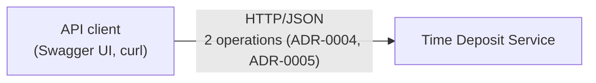
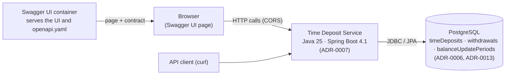
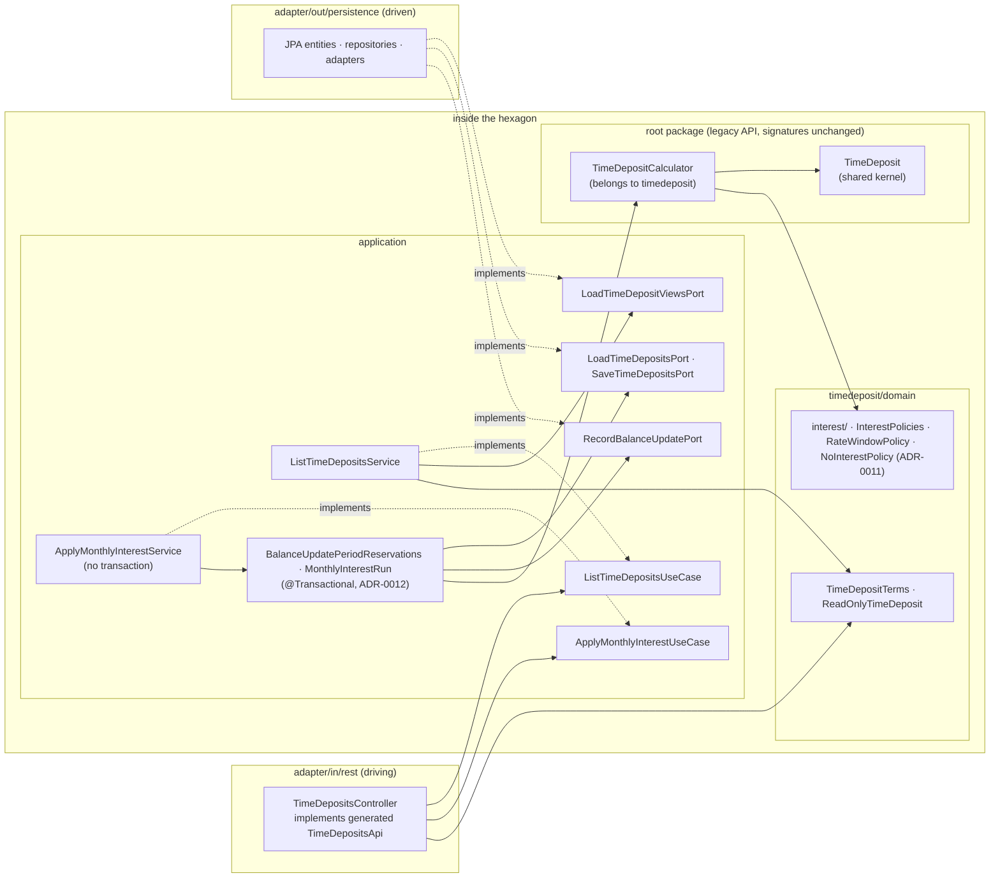
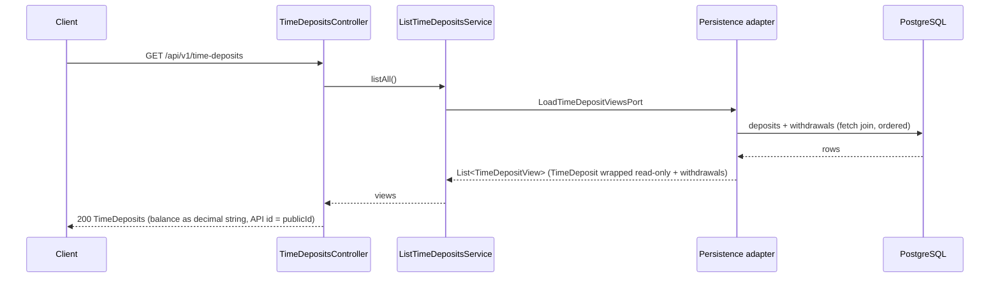
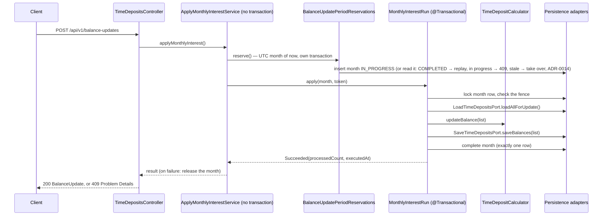

# Architecture Overview

How the Time Deposit service is structured. Each section summarises accepted decisions; the ADRs hold the
reasoning ([ADR index](../adr/README.md)); open topics are listed there under *Planned decisions*.

## 1. System context (C4 level 1)
An API client (a developer using Swagger UI or `curl`) lists time deposits and triggers the monthly balance
update. The service stores time deposits and their withdrawals.

## 2. Containers (C4 level 2)

- The application serves exactly the two contract operations; Swagger UI runs as its own container
  (ADR-0005). The UI reaches the API through the contract's server URL `http://localhost:8080/api/v1`, with CORS
  allowing the UI's origin (ADR-0010).
- Schema and demo seed data are applied by Flyway (ADR-0006).

## 3. Components (C4 level 3)
Hexagonal architecture (Ports & Adapters), organised by capability (ADR-0008). Today there is one capability,
`timedeposit`; later capabilities (e.g. `withdrawal`) get the same inner layout.

- **Dependencies point inward:** adapters depend on ports; the application depends on the domain; the domain has
  no framework dependencies. ArchUnit enforces the rules of ADR-0008.
- **Ports:** `port.in` is the driving side (the application's API), `port.out` the driven side (what it needs).
- **Wiring:** implementations of `port.in` carry `@UseCase` (a `@Service` stereotype); the transactional steps of
  the balance update are plain `@Service` beans (ADR-0012 B); `TimeDepositCalculator` is an explicit `@Bean`
  in `configuration`; the main class sits in the root package.

## 4. Key flows

### List time deposits — `GET /api/v1/time-deposits`

### Apply monthly interest — `POST /api/v1/balance-updates`

At most one run per UTC calendar month (ADR-0013), with ADR-0012's serialisation (row locks), reservation, liveness
(`SKIP LOCKED`), stale takeover, fence and release keyed by the month; a failing deposit aborts the whole run.

## 5. Cross-cutting concerns
- **Data model:** tables, columns, constraints and the Java mapping as they are today:
  [data-model.md](data-model.md).
- **Money:** stored as `NUMERIC(15,2)` (ADR-0006); the legacy domain computes in `Double`; the persistence adapter
  reads with `BigDecimal.doubleValue()` and writes with `BigDecimal.valueOf(..).setScale(2, HALF_UP)`; the API
  shows decimal strings with two fraction digits (ADR-0004).
- **Identifiers:** the API `id` is the `publicId` UUID; internal integer keys never reach the API
  (ADR-0004, ADR-0006).
- **Persistence mapping:** JPA entities exist only in the persistence adapter and are mapped two-way to
  `TimeDeposit`; identifiers are quoted camelCase as in the brief (ADR-0006, ADR-0008).
- **Transactions:** adapters call services only through `port.in` (ADR-0008). A use case that needs exactly one
  transaction would carry `@Transactional` itself (ADR-0008 decision 7); today neither does. The balance update needs
  several, so `ApplyMonthlyInterestService` has none and
  calls `BalanceUpdatePeriodReservations` (reserve, release) and `MonthlyInterestRun` (the run), each committed on
  its own (ADR-0012 B). The list reads in one statement and needs no transaction.
- **Errors:** RFC 9457 Problem Details for all errors handled by Spring MVC, including `404` for unknown paths;
  no other HTTP routes exist (ADR-0003, ADR-0005).
- **Testing:** unit tests for domain and application with in-memory fakes of `port.out`; integration tests
  (`src/integrationTest`, Testcontainers) for adapters and endpoints; ArchUnit for the architecture rules
  (ADR-0007, ADR-0008, ADR-0009, ADR-0015; guide: [testing.md](../testing.md)).

## Related decisions
| Topic | ADR |
|---|---|
| Contract-first OpenAPI | [ADR-0002](../adr/0002-contract-first-openapi.md) |
| API conventions, errors | [ADR-0003](../adr/0003-api-conventions.md) |
| Time deposit API design | [ADR-0004](../adr/0004-time-deposit-api-design.md) |
| Endpoint scope | [ADR-0005](../adr/0005-endpoint-scope.md) |
| Data model (current state: [data-model.md](data-model.md)) | [ADR-0006](../adr/0006-data-model.md), [ADR-0013](../adr/0013-interest-periods.md) |
| Technology stack and build | [ADR-0007](../adr/0007-technology-stack-and-build.md) |
| Hexagonal architecture | [ADR-0008](../adr/0008-hexagonal-architecture.md) |
| Testing strategy | [ADR-0009](../adr/0009-testing-strategy.md), [ADR-0015](../adr/0015-testing-strategy-as-built.md) |
| Local runtime (Docker Compose, Swagger UI, CORS) | [ADR-0010](../adr/0010-local-runtime.md) |
| Interest calculation (policies) | [ADR-0011](../adr/0011-interest-calculation-design.md) |
| Balance update: consistency, month rule, replay | [ADR-0012](../adr/0012-balance-update-consistency.md), [ADR-0013](../adr/0013-interest-periods.md), [ADR-0014](../adr/0014-replay-completed-month-without-lock.md) |
