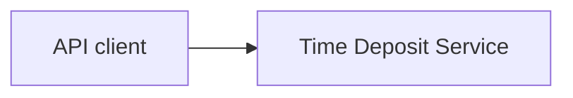
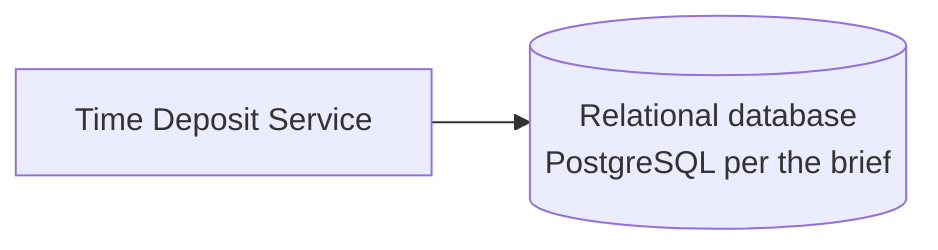

# Architecture Overview

> Skeleton — sections are completed as the related ADRs are accepted.

## 1. System context (C4 level 1)
_TBD — see upcoming ADRs._

## 2. Containers (C4 level 2)
_TBD — application technology and integration are decided in upcoming ADRs._

## 3. Components (C4 level 3)
_TBD — hexagonal structure (ports & adapters), see architecture ADRs._

## 4. Key flows
_TBD — list time deposits; update all balances._

## 5. Cross-cutting concerns
_TBD — money representation, persistence mapping, transactions._

## Related decisions
See [ADR index](../adr/README.md).
